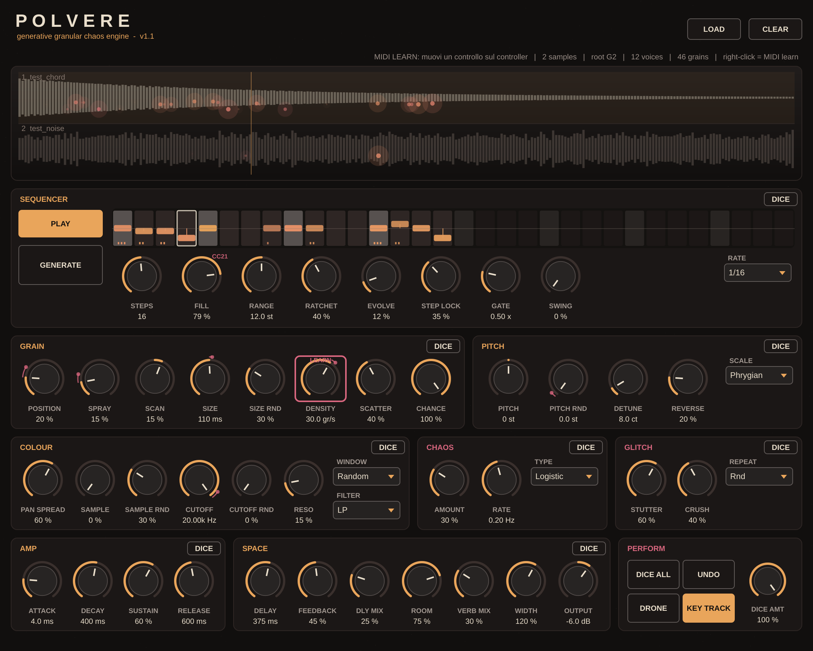

# POLVERE — granular dust engine

Sintetizzatore granulare generativo (AU / VST3 / Standalone) costruito con JUCE 8.
Suona da solo: un sequencer interno genera pattern sincronizzati al tempo della DAW.
Trascini dentro tutti i sample che vuoi (anche cartelle intere) e lui li polverizza
in una nuvola di grani dove quasi tutto è randomizzato, e lentamente "balla" da solo.



## Funzioni

**Sequencer generativo (suona in automatico)**
- PLAY / GENERATE: nuovo pattern a ogni pressione (anche da controller)
- Steps 1-32, Rate 1/64 → 1 bar (anche terzine), Fill, Range note, Ratchet, Gate, Swing
- Evolve: a ogni giro una parte degli step si rigenera da sola
- Step Lock: ogni step ha la sua posizione nel sample e durata dei grani
- Sincronizzato al tempo della DAW quando è in play, altrimenti corre da solo a 120 bpm
- Le note MIDI in ingresso trasportano il pattern (root)

**Tutto mappabile**
- Ogni parametro è automatizzabile/mappabile dalla DAW
- MIDI Learn interno: tasto destro su qualsiasi knob, menu o pulsante → muovi il controller
- GENERATE, DICE e UNDO sono trigger mappabili (usa i pad in modalità momentanea)
- Le mappature vengono salvate con il progetto

**Chaos & Glitch**
- Chaos Type: Drift (random walk), Lorenz (attrattore caotico), Step S&H, Logistic map
- Stutter: ripete fette dell'uscita sincronizzate (1/8 → 1/64 o casuale)
- Crush: bit depth + sample rate reduction

**Pool di sample**
- Drag & drop di file e cartelle (ricorsivo): wav, aif, flac, mp3, ogg, caf, m4a — fino a 128 sample
- Ogni sample ha una sua corsia nella nuvola; click = focus su quel sample, tasto destro = rimuovi
- Normalizzazione automatica a -1 dBFS, sample rate diversi gestiti in automatico
- I percorsi vengono salvati nel progetto della DAW e ricaricati

**Motore granulare** (fino a 512 grani, 8 voci)
- Position / Spray / Scan (testina che scorre avanti o indietro)
- Size + Size Random (fino a ±2 ottave di durata), Density 0.5–200 grani/s
- Chaos: da sincrono (ritmico) a Poisson (nuvola asincrona)
- Chance: probabilità che ogni grano suoni (diradare, stutter)
- 6 finestre (Hann, Gauss, Tukey, Triangle, Expodec, Rexpodec) + Random per grano
- Interpolazione Hermite, Reverse probabilistico, pan equal-power random

**Pitch**
- Pitch ±24 st, Pitch Random fino a 24 st quantizzato su scala:
  Free, Chromatic, Octave, Oct+5th, Minor, Major, Phrygian, Dorian, Pentatonic, Hijaz
- Detune random in cent per grano, Key Track on/off

**Colore**
- Filtro SVF per ogni singolo grano (LP/BP/HP) con cutoff randomizzato per grano
- Sample Select + Sample Random (ogni grano può pescare da un sample diverso del pool)

**Modulazione Chaos**
- Modulatori indipendenti che fanno derivare Position, Size, Density,
  Pitch Random, Cutoff e Spray. L'anello rosa sui knob mostra il valore reale in quel momento

**Dice**
- DICE ALL e un DICE per ogni sezione, con range "musicali" (niente silenzio o rumore inutile)
- DICE AMT: 100% = salto totale, valori bassi = piccola mutazione dal suono attuale
- UNDO (32 livelli)

**Amp & Space**
- ADSR per voce, modalità DRONE (suona senza MIDI)
- Ping-pong delay con feedback smorzato, riverbero, stereo width, soft clip in uscita

## Build

Serve CMake ≥ 3.22. JUCE viene scaricato in automatico.

```bash
cd polvere
cmake -B build -DCMAKE_BUILD_TYPE=Release -DCMAKE_OSX_ARCHITECTURES="arm64;x86_64"
cmake --build build --config Release -j
```

Su macOS l'AU viene copiato in automatico in `~/Library/Audio/Plug-Ins/Components`.
Verifica: `auval -v aumu Plvr Ltbb`.

### Build automatica
Il workflow `.github/workflows/polvere-macos.yml` compila AU + VST3 + Standalone su macOS,
li valida con `auval` e li pubblica come artifact `Polvere-macOS` nella pagina Actions.

Il plugin è firmato ad-hoc (non notarizzato): dopo il download togli la quarantena
```bash
xattr -dr com.apple.quarantine ~/Library/Audio/Plug-Ins/Components/Polvere.component
```

### Test offline
```bash
cmake -B build -DPOLVERE_BUILD_TESTS=ON && cmake --build build --target PolvereRenderTest
./build/PolvereRenderTest_artefacts/Release/PolvereRenderTest /cartella/output
```
Genera sample di test, suona MIDI + drone, controlla NaN/livelli, salva un WAV e uno screenshot della GUI.
